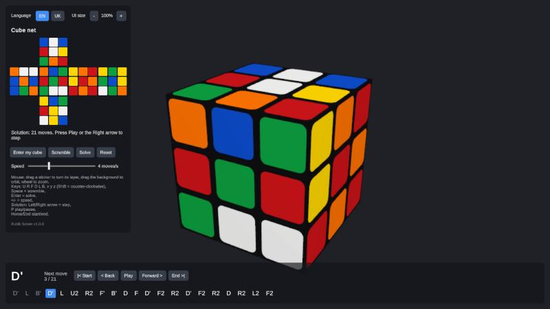

# Rubik Solver

Enter the colors of your Rubik's cube and get a short step-by-step solution, played back on an animated 3D cube.

**[Open the web app](https://gaveloshpom.github.io/RubikSolver/)** · **[Download for Windows](https://github.com/Gaveloshpom/RubikSolver/releases/latest)**



## Features

- **Enter your own cube** by painting stickers on the net or right on the 3D cube. The app checks that the cube can actually exist: right number of each color, no impossible corners or edges, no twisted corner, flipped edge or swapped pair.
- **Short solutions, fast**: a two-phase (Kociemba) solver finds ~20-move solutions in tens of milliseconds, with a layer-by-layer solver as a fallback.
- **Solution player**: step forward and back, play/pause, jump to any move, speed from 0.5 to 12 moves per second. The next move is shown in large letters so you can follow along on a real cube.
- **3D cube you can play with**: drag a sticker to turn its layer, drag the background to orbit, scroll or pinch to zoom, or use the keyboard.
- Works on phones too: touch controls and a compact layout with a Menu button.
- English and Ukrainian UI, adjustable UI size.

## How to use

1. Hold your cube with the **white centre on top** and the **green centre facing you**.
2. Click **Enter my cube**, pick a color (or press 1–6) and paint each sticker of the net to match your cube.
3. When the status says the cube is valid, click **Done**, then **Solve**.
4. Use **Forward** (or the Right arrow) to go move by move, or **Play** to watch the whole solution.

Moves use standard notation: `R` turns the right face clockwise (looking at that face), `R'` counter-clockwise, `R2` a half turn.

### Keyboard

| Keys | Action |
|---|---|
| U R F D L B, x y z | Turn a face / rotate the cube (Shift = counter-clockwise) |
| Space / Enter / Backspace | Scramble / solve / reset |
| Left, Right | Step through the solution |
| P, Home, End | Play/pause, jump to start/end |
| + / - | Speed |

## Download and run

- **Web**: works in any modern browser on desktop or phone, nothing to install.
- **Windows**: download `RubikSolver-<version>-win64.zip` from [Releases](https://github.com/Gaveloshpom/RubikSolver/releases), unzip and run `RubikSolver.exe`. The app is not code-signed, so SmartScreen may warn on first start: **More info → Run anyway**.

## How it works

The project is split into a plain C# engine and a Unity front-end that uses it as DLLs.

| Path | What |
|---|---|
| `src/Rubik.Core` | NxN cube model, moves, notation, scrambler (netstandard2.1) |
| `src/Rubik.Solver3x3` | Two-phase solver, layer-by-layer solver, solvability check |
| `src/Rubik.Cli` | Console front-end |
| `tests/` | Engine and solver tests |
| `unity/RubikApp` | Unity 6.6 (URP) app for Windows and the web, see [unity/README.md](unity/README.md) |

**Engine.** The cube is stored as stickers (`byte[6*N*N]`, the same facelet order as Kociemba: U R F D L B). Every sticker has integer 3D coordinates, so a quarter turn is an exact integer rotation for any N, with no hand-written permutation tables. A single `Move` type, `(Axis, LayerFrom, LayerTo, Turns)`, covers outer faces, inner slices, wide moves and whole-cube rotations, which is what lets the same engine handle bigger cubes later.

**Two-phase solver.** `KociembaSolver` works on coordinates (corner/edge orientation, UD-slice, permutations) with move tables and pruning tables. Phase 1 brings the cube into the subgroup ⟨U, D, R2, L2, F2, B2⟩, phase 2 solves it inside that subgroup. Tables build in about 0.2 s; on 200 random scrambles the median solve takes ~25 ms and solutions average 20 moves.

**Layer-by-layer solver.** `LayerByLayerSolver` solves cross, first-layer corners, second-layer edges, OLL and PLL, checking every step on the real cube. It is used as a fallback when the two-phase search hits its time limit.

**Validity check.** `CubeValidator` rejects cubes that cannot be solved: wrong color counts, impossible pieces, a twisted corner, a flipped edge or an odd permutation.

**Unity app.** `CubeView` renders the model and animates moves (the model stays the single source of truth), `CubeAppController` runs the solver off the main thread on desktop (on the main thread in the browser, which has no threads), and the UI is built in code with UI Toolkit.

## Building from source

Requirements: .NET SDK 8+, Unity 6000.6.3f1 with the Windows and Web build modules.

```bash
dotnet build
dotnet run --project src/Rubik.Cli -- -s 20 --solve                # console demo
dotnet run --project tests/Rubik.Solver3x3.Tests -c Release        # solver tests
dotnet run --project tests/Rubik.Tests.Offline                     # engine tests (no NuGet needed)
```

For the Unity app, copy the engine DLLs into the project, then open `unity/RubikApp` in Unity Hub:

```bash
powershell -ExecutionPolicy Bypass -File unity/sync-solver.ps1
```

The `Rubik` menu in the editor builds the Windows zip and the web version; [unity/README.md](unity/README.md) describes building and publishing.

## Roadmap

- Bigger cubes (4x4 and up): the engine already supports any N, the solver does not yet

## License

[MIT](LICENSE.txt)

The app's UI font is [Inter](https://github.com/rsms/inter), licensed under the SIL Open Font License 1.1 ([license](unity/RubikApp/Assets/Resources/Fonts/Inter-LICENSE.txt)).
